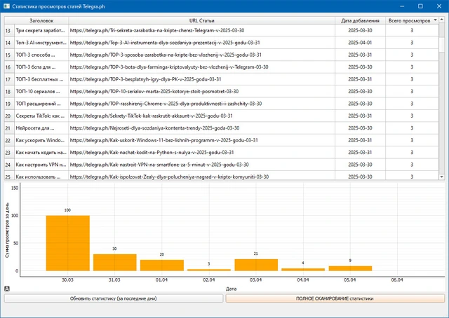

# ClickFarm

Набор связанных инструментов для работы со статьями: генерация текста через Gemini, подготовка ссылок, публикация и редактирование в Telegraph. Отдельное настольное приложение показывает общие и дневные просмотры, сохраняя историю в SQLite.

**Python-портфолио Евгения Толмачева** · Python · PyQt5 · Gemini API · Telegraph API · SQLite · Selenium



## Возможности

- Генерирует тексты статей через Gemini с учётом уже сохранённых заголовков в запросе.
- Подготавливает короткие ссылки и публикует HTML-содержимое в Telegraph.
- Сохраняет текст, адрес публикации и сведения о ссылках в локальной базе.
- Позволяет обновлять опубликованные статьи отдельным скриптом.
- Загружает просмотры за выбранные даты, сохраняет недостающие записи и отображает таблицу и график.

## Как устроен проект

### Генерация

`articles_generator.py`

Собирает контекст из сохранённых заголовков, обращается к Gemini и сохраняет подготовленный текст.

### Публикация и правки

`telegraph_poster_shortlinks_v2.py`, `telegraph_zamena.py`

Обрабатывают ссылки, создают страницы Telegraph и обновляют содержимое существующих статей.

### Локальное хранилище

`init_db.py`

Создаёт таблицу статей; данные публикаций и статистика затем используются другими инструментами.

### Статистика

`stats_viewer.py`

Загружает просмотры в рабочем потоке, записывает дневные значения в SQLite и обновляет таблицу и график.

## Технологии и их роль

- **Gemini и Telegraph API**: Генерация текста, публикация, редактирование и получение просмотров.
- **SQLite**: Хранение статей и накопленной дневной статистики.
- **PyQt5 и pyqtgraph**: Настольный просмотрщик с таблицей, графиком и индикатором загрузки.
- **Selenium и потоки**: Обработка коротких ссылок через браузер и параллельные сетевые операции.

## Что смотреть в коде

Связь этапов видна в articles_generator.py и telegraph_poster_shortlinks_v2.py. В stats_viewer.py стоит посмотреть DataLoaderThread и сохранение дневной статистики.

## Структура

```text
ClickFarm/
├── docs/
│   └── preview.webp
├── .env.example
├── .gitignore
├── articles_generator.py
├── generate_token.py
├── init_db.py
├── README.md
├── README.public.md
├── requirements.txt
├── stats_viewer.py
├── telegraph_poster_shortlinks_v2.py
└── telegraph_zamena.py
```

## Подготовка и запуск

Это сохранённая версия пет-проекта, показывающая этап развития навыков. Для воспроизведения создайте отдельное окружение Python, совместимое с зафиксированными зависимостями:

```powershell
python -m venv .venv
.venv\Scripts\Activate.ps1
python -m pip install -r requirements.txt
```

Сначала создайте локальную базу: python init_db.py. Для генерации и публикации нужны собственные настройки Gemini, сервиса коротких ссылок и Telegraph. Рабочие базы, токены и история публикаций исключены. Запускайте модули публикации только после проверки настроек.

Переменные окружения: `GEMINI_API_KEY`, `URLLY_API_TOKEN`. Образец находится в [.env.example](.env.example). Сам файл .env автоматически не загружается: исходники читают окружение процесса. Значения нужно передать перед запуском, например в PowerShell:

```powershell
$env:GEMINI_API_KEY = "YOUR_VALUE"
```

После подготовки настроек и необходимых данных основная точка входа:

```powershell
python stats_viewer.py
```

`requirements.txt` сохранён из проекта. Это снимок окружения, а не гарантия совместимости с новейшей версией Python. Для старых проектов могут потребоваться соответствующая версия Python и настройка системных компонентов.

## Контекст проекта

Проект 2025 года объединяет несколько этапов работы с контентом общим хранилищем. Генератор, издатель и просмотрщик статистики запускаются независимо. В центре реализации - интеграции API, хранение результатов и фоновая загрузка данных для интерфейса.

## Состав публикации

В репозитории оставлены авторские исходники, зависимости и один компактный скриншот. Виртуальные окружения, сторонние библиотеки, рабочие базы, модели, большие наборы данных и персональные настройки не включены.

Чувствительные значения заменены понятными заглушками `YOUR_...` / `REDACTED_...`. Настоящие доступы не следует добавлять в Git. Алгоритмы и структура проекта при подготовке публикации не перерабатывались.

Проверена синтаксическая корректность Python-файлов и выполнено сканирование публикуемой копии на секреты. Полный запуск с внешними API, платежами, биржевыми операциями и локальными моделями не выполнялся.

Автор: [Евгений Толмачев](https://github.com/EvgenyET) · [Портфолио](https://evgeny.tech/)
